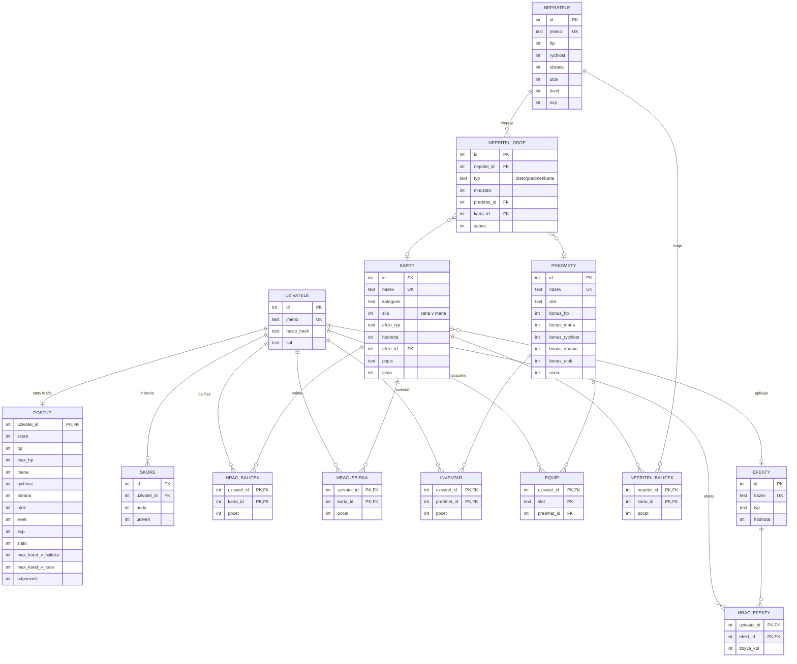

# ER diagram

## Co je v DB a co jen v paměti hry

| Údaj | Kde | Proč |
|---|---|---|
| Staty hráče (HP, útok, level, zlato…) | DB `postup` | trvalé |
| Sbírka a balíček karet | DB `hrac_sbirka`, `hrac_balicek` | trvalé; balíček = výběr ze sbírky |
| Inventář, equip | DB `inventar`, `equip` | trvalé |
| Efekty na hráči | DB `hrac_efekty` | jen pokud se ukládá hra uprostřed souboje |
| **Ruka, lízací balíček, odhazovací balíček** | **paměť hry** | existují jen během souboje; na jeho začátku se lízací balíček vytvoří z `hrac_balicek` a zamíchá |
| Aktuální mana v souboji | paměť hry | na začátku kola se doplní na hodnotu `postup.mana` |
| Efekty a HP nepřítele v souboji | paměť hry | nepřítel se vytvoří kopií řádku z `nepratele` |

## Poznámky k návrhu

- **Mana** v `postup` je maximum (default 5); aktuální hodnota je jen v souboji. `karty.sila` je cena many.
- **Popis efektu karty** je rozdělen na strojově čitelné `efekt_typ` + `hodnota` (pro logiku hry) a `popis` (text pro hráče).
- **Equip**: každý slot má max. jednu věc. Prsteny mají sloty `prsten_1`, `prsten_2`. Obouruční zbraň vylučuje `zbran` a `stit` (kontroluje hra).
- **Limity** `max_karet_v_balicku` a `max_karet_v_ruce` jsou ve `postup`, aby šly zvyšovat předměty/levelem; součet `hrac_balicek.pocet` hlídá hra.
- **Drop** má `sance` v % a omezení, že řádek odkazuje právě na zlato, předmět, nebo kartu.
- **Bonusy předmětů** se při souboji sčítají ze všech řádků `equip`.
- **Rychlost** může určovat, kdo hraje v kole první.
