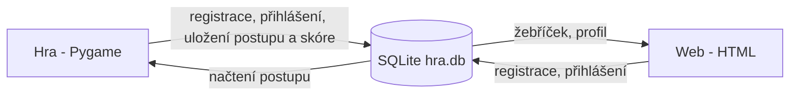

# Plán projektu – Card Battle RPG (fáze 1)

## Rozložení složek

```
Fáze 1/
  main.py            hra (Pygame, hlavní menu)
  settings.py        konstanty
  databaze/
    schema.sql       CREATE TABLE skripty
    database.py      funkce pro práci s DB
    er_diagram.md    ER diagram
    hra.db           vznikne po spuštění database.py
  webova_stranka/    HTML (index, login, registrace, žebříček)
  plan_projektu.md
```

## Datové toky (co – kde – kam – odkud)



| Co | Odkud | Kam |
|----|-------|-----|
| Registrace / přihlášení | hra, web | tabulka `uzivatele` |
| Uložení postupu | hra | tabulka `postup` |
| Skóre po souboji | hra | tabulka `skore` |
| Žebříček | tabulka `skore` | web |

## Splněno ve fázi 1

- [x] Téma: karetní RPG
- [x] ER diagram a CREATE TABLE skripty
- [x] Hlavní menu (start, nastavení, konec) v Pygame
- [x] Struktura HTML souborů a navigace
- [ ] Web zatím bez backendu (login a registrace přijdou ve fázi 2)
